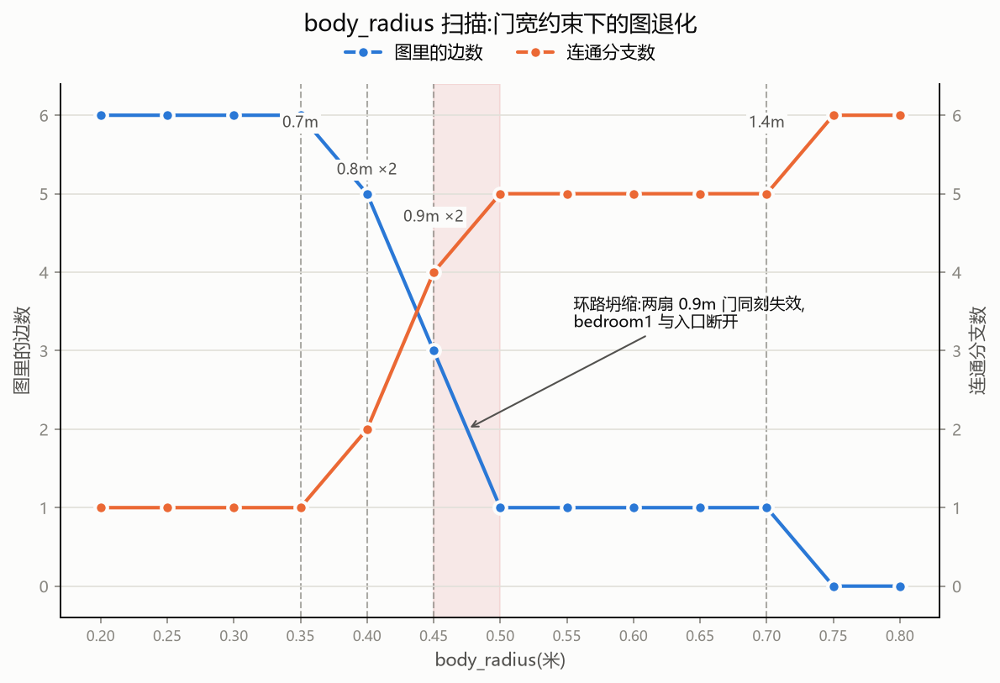

# spatial-topology

**Same building, different graphs.**
A floor plan is not one topology but many. Describe rooms and doors in a single JSON, and this toolkit turns it into a NetworkX graph — rebuilt per body size: a door narrower than twice the passer-by's body radius is not an edge at all. As the radius grows, one apartment degenerates, step by step, into isolated rooms.



*Edges (blue, left axis) vanish while connected components (orange, right axis) climb. Dashed lines mark door-width thresholds; the shaded band is where the balcony ring collapses.*

## The finding: equal-bottleneck loops are pseudo-redundant

In `demo.json`, `living` reaches `bedroom1` in two ways:

- the direct door, 0.9 m wide;
- around the balcony ring: a 1.4 m sliding door plus bedroom1's 0.9 m door — bottleneck still 0.9 m.

Graph-theoretically that is a cycle — textbook redundancy. But both paths share their narrowest point. A door passes iff `width ≥ 2 × body_radius`, so the moment body_radius exceeds 0.45 m, both 0.9 m doors die in the same step. The 1.4 m balcony edge survives, but only as a dangling edge nobody can walk through: `bedroom1` is unreachable from `living` all the same. (Components jump 4 → 5 at r = 0.50; the ring's surviving edge itself doesn't disappear until 0.70.)

**Standard space syntax cannot see this.** It records adjacency, not widths: it draws the same ring and credits it with a robustness it doesn't have. Once doors carry widths, a ring counts as real redundancy only when its paths' bottlenecks *differ*.

## Quick start

Python 3.11. On Windows the system interpreter is `py` (inside the venv, `python` works).

Install:

```bash
git clone https://github.com/XinzhouZ/spatial-topology.git
cd spatial-topology
py -m venv venv && venv/Scripts/python -m pip install networkx matplotlib
```

Run:

```bash
venv/Scripts/python topology.py     # per-door failure radii + body_radius sweep table
venv/Scripts/python plot_sweep.py   # renders breakdown_curve.png
```

You should see (excerpt):

```text
   r    边数  分支  不可达房间(入口: living)
0.45     3     4  kitchen, bedroom2, bathroom
0.50     1     5  bedroom1, kitchen, bedroom2, bathroom
0.75     0     6  bedroom1, balcony, kitchen, bedroom2, bathroom
```

## JSON format

See [`demo.json`](demo.json) for the full six-room plan with the balcony ring.

```json
{
  "rooms": [
    {"id": "living", "min_x": 2.0, "max_x": 8.0, "min_z": 2.0, "max_z": 6.0}
  ],
  "doors": [
    {"a": "living", "b": "balcony", "z": 2.0, "width": 1.4}
  ],
  "start": "living"
}
```

| field | meaning |
|---|---|
| `rooms[].id` | unique room id |
| `rooms[].min_x / max_x / min_z / max_z` | room rectangle, meters, plan view on the x–z ground plane |
| `doors[].a`, `doors[].b` | the two rooms the door joins |
| `doors[].z` | door-center z coordinate; on an east–west wall this is the wall's z — the along-wall position is not yet encoded (a future `x` field will) |
| `doors[].width` | clear door width, meters |
| `start` | entry room id; the sweep measures reachability from here |

## Why

Architecture abstracts buildings into graphs as if doors were binary and bodies were points. Neither is true: a door is a width, a body is a radius — and the topology of a building is a function of both. Same plan, different body, different graph: that is an accessibility statement (wheelchair, adult, robot), an evacuation statement, and a modeling statement in one picture.

One JSON is the single source of truth. Roadmap: the same spec will also build a MiniWorld 3D world, so the graph you compute and the space an agent actually walks can be checked against each other.

## License

[MIT](LICENSE) © Xinzhou Zhang

---

## 中文说明

**同一栋楼,对不同尺寸的通行者是不同的图。**
用一份 JSON 描述房间和门,工具把它建成 NetworkX 图,并按通行者身材逐档重建:门洞宽度小于两倍身体半径的门,在图上根本不算一条边。半径增大,同一套住宅一步步退化成孤立的房间。

(退化曲线见上方图片:蓝线是边数,橙线是连通分支数,竖虚线是各门宽的失效阈值,红色阴影带是阳台环坍缩的位置。)

### 核心发现:瓶颈相同的环路是伪冗余

`demo.json` 里 `living` 到 `bedroom1` 有两条路:

- 直门,宽 0.9 米;
- 绕阳台的环:1.4 米推拉门 + 主卧那扇 0.9 米门——瓶颈仍是 0.9 米。

图论上这是个环,是教科书式的冗余。但两条路共享同一个最窄处。规则是"宽度 ≥ 2 × body_radius 才能通过",所以 body_radius 越过 0.45 米的瞬间,两扇 0.9 米的门同刻失效;1.4 米的阳台边虽然还活着,却成了谁也走不通的悬边——`bedroom1` 照样与入口断开(r = 0.50 时连通分支从 4 跳到 5,那条悬边自己要到 0.70 才消失)。

**标准空间句法看不见这个现象**:它只记录相邻,不记录宽度,会把同样的环画出来,并赋予它并不具备的鲁棒性。门一旦有了宽度,一个环只有在其各条路径瓶颈互异时,才算真冗余。

### 快速开始

Python 3.11。Windows 下系统解释器是 `py`(venv 激活后 `python` 可用)。

```bash
git clone https://github.com/XinzhouZ/spatial-topology.git
cd spatial-topology
py -m venv venv && venv/Scripts/python -m pip install networkx matplotlib
```

```bash
venv/Scripts/python topology.py     # 门失效半径清单 + body_radius 扫描表
venv/Scripts/python plot_sweep.py   # 生成 breakdown_curve.png
```

### JSON 格式

完整六房间户型见 [`demo.json`](demo.json)。字段含义:

| 字段 | 含义 |
|---|---|
| `rooms[].id` | 房间唯一 id |
| `rooms[].min_x / max_x / min_z / max_z` | 房间矩形范围,单位米,俯视 x–z 地面坐标系 |
| `doors[].a`、`doors[].b` | 门连接的两个房间 |
| `doors[].z` | 门洞中心 z 坐标;位于东西向墙(恒定 z)上时即为墙的 z,门洞沿墙位置暂未编码(将来加 `x` 字段) |
| `doors[].width` | 门洞净宽,米 |
| `start` | 入口房间 id,扫描从这里出发 |

### 为什么做这个

建筑学把平面抽象成图时,默认门是二值的、身体是一个点。两者都不成立:门是一个宽度,身体是一个半径,而一栋楼的拓扑是两者的函数——同一张平面,不同的身体,不同的图。这一张图同时是可达性陈述(轮椅、成人、机器人)、疏散陈述和建模陈述。

整个项目只用一份 JSON 作为唯一数据源。后续计划:同一份规格还将生成 MiniWorld 三维世界,让算出来的图和智能体真正走的空间互相印证。

### 许可证

[MIT](LICENSE),作者 Xinzhou Zhang。
