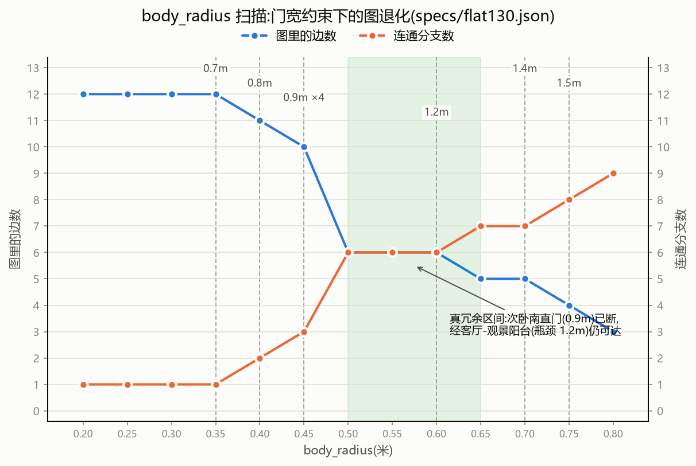

# spatial-topology

**Same building, different graphs.**
A small tool that treats body size as a continuous parameter and sweeps it: for a floor plan described in JSON, it builds a room-adjacency graph in which a door narrower than twice the passer-by's body radius is not an edge at all — and plots how that graph degrades as the radius grows. It is built for the downstream audit of procedurally generated indoor environments: many candidate plans, each summarized by one cheap degradation curve.



*Sweep over `flat130.json`: edges (blue, left axis) fall while connected components (orange, right axis) climb. Dashed lines mark door-width thresholds; the green band marks the interval where a bedroom stays reachable through a redundant detour.*

## The two spec files

- [`specs/demo.json`](specs/demo.json) — a **constructed teaching example**, not a real plan. A compact two-bedroom flat whose balcony ring deliberately has equal bottlenecks, used to exhibit pseudo-redundancy.
- [`specs/flat130.json`](specs/flat130.json) — modeled on a **real apartment** (~130 m², three bedrooms, two bathrooms, an east–west corridor spine, service and viewing balconies). Its balcony detour has distinct bottlenecks and is genuinely redundant.

## Equal-bottleneck vs distinct-bottleneck rings

A graph cycle means redundancy only while every path along it stays passable, and a path's capacity is its bottleneck — the narrowest door on it. Two regimes follow:

- **Equal bottlenecks fail simultaneously (pseudo-redundancy).** In `demo.json`, `living` reaches `bedroom1` through a 0.9 m direct door or around the balcony ring (1.4 m sliding door + 0.9 m bedroom door; bottleneck still 0.9 m). When body_radius passes 0.45 m both 0.9 m doors fail in the same step. The 1.4 m edge survives as a dangling edge nobody can use: `bedroom1` is unreachable all the same.
- **Distinct bottlenecks fail staggered (true redundancy).** In `flat130.json`, `bedroom_s` has a 0.9 m corridor door, backed by a detour through the viewing balcony bottlenecked at 1.2 m. Between radii 0.45 m and 0.60 m the direct door is gone but the room is still reachable.

The discriminant is simply whether the detour's bottleneck is strictly wider than the direct path's. On the sweep curves it is visible as: **edges fall while connected components hold** (true redundancy) versus **edges fall and components jump** (pseudo-redundancy, the house shatters).

One boundary caveat: when `width == 2·body_radius` exactly, the pass/fail outcome is a knife edge. `truth_check.py` ran 60 physical door-crossing trials in MiniWorld: 57 agreed with the graph, and the 3 disagreements all sit exactly on the boundary, where ±1-ulp rounding in the collision geometry decides the result. `build_graph` therefore accepts an optional `margin` (rule: `width ≥ 2·body_radius + margin`) so a conservative analysis can push exact-boundary cases into the fail region.

## Usage

Python 3.11. On Windows the system interpreter is `py` (inside the venv, `python` works).

Install:

```bash
git clone https://github.com/XinzhouZ/spatial-topology.git
cd spatial-topology
py -m venv venv && venv/Scripts/python -m pip install networkx matplotlib
```

Run from the repo root (any spec file; `specs/demo.json` by default):

```bash
venv/Scripts/python src/topology.py specs/flat130.json     # door table, radius sweep, edge impacts (terminal + CSV)
venv/Scripts/python src/plot_plan.py specs/flat130.json    # floor-plan drawing → outputs/plan.png
venv/Scripts/python src/plot_sweep.py specs/flat130.json   # degradation curve → outputs/breakdown_<spec>.png
venv/Scripts/python src/truth_check.py specs/flat130.json  # physical door-crossing trials vs graph predictions
```

`topology.py` writes `outputs/doors_<spec>.csv`, `outputs/sweep_<spec>.csv`, `outputs/impacts_<spec>.csv` alongside the terminal output.

## JSON format

See [`specs/demo.json`](specs/demo.json) for a minimal example and [`specs/flat130.json`](specs/flat130.json) for a full real-plan-based one.

| field | meaning |
|---|---|
| `rooms[].id` | unique room id |
| `rooms[].min_x / max_x / min_z / max_z` | room rectangle, meters, plan view on the x–z ground plane |
| `doors[].a`, `doors[].b` | the two rooms the opening joins |
| `doors[].pos` | opening-center coordinate along the shared wall (z for walls at constant x, x for walls at constant z) |
| `doors[].width` | clear width, meters; for a fully open wall (e.g. living–corridor in `flat130.json`) this is the whole shared-wall length |
| `entrance` (optional) | the unit entry door, which belongs to no room: `{"room", "orient", "coord", "pos", "width"}` |
| `start` | entry room id; the sweep measures reachability from here |

## Related work

Making door widths and body sizes first-class in route analysis is an established concern in architecture and BIM, not an open blank this repo fills:

- **Accessible route analysis** in architecture/BIM: accessible route graphs go back to at least 2002, with opening nodes carrying three clear-width components (door width plus approach clearances on both sides).
- **Emergency egress and evacuation accessibility models** incorporate door widths, corridor widths, and turning spaces.
- **Automated ADA compliance checking** quantifies door clear widths and maneuvering clearances directly from BIM.

Space syntax indeed does not record door widths, and researchers who need them already work with the toolchains above. This repo is a lightweight, room-adjacency-graph implementation — meant for auditing procedurally generated indoor environments, where many candidate plans each need a cheap degradation curve — not a replacement for those tools.

## Why

Textbook graph abstractions of buildings treat doors as binary and bodies as points. Doors have widths and bodies have radii, and the topology of a building is a function of both: same plan, different body, different graph — an accessibility statement (wheelchair, adult, robot), an evacuation statement, and a modeling statement in one picture.

One JSON is the single source of truth. The target workflow is auditing procedurally generated indoor environments: every generated plan gets one cheap degradation curve before costlier checks. Roadmap: the same spec will also build a MiniWorld 3D world, so the graph you compute and the space an agent actually walks can be checked against each other.

## License

[MIT](LICENSE) © Xinzhou Zhang

---

## 中文说明

**同一栋楼,对不同尺寸的通行者是不同的图。**
一个把身体尺寸作为连续参数来扫描的小工具:用 JSON 描述房间和门,建成房间邻接图——门洞宽度小于两倍身体半径的门,在图上不算一条边——然后画出图随半径增大的退化曲线。定位于后续审计程序化生成的室内环境:候选方案成批出现,每份户型用一条低成本的退化曲线概括。

(退化曲线见上方图片:蓝线是边数,橙线是连通分支数,竖虚线是各门宽的失效阈值,绿色阴影带是次卧南靠冗余绕行保持可达的区间。)

### 两个规格文件

- [`specs/demo.json`](specs/demo.json) —— **构造出来的教学例子**,不是真实户型:一个紧凑两居,阳台环刻意做成等瓶颈,用来展示伪冗余。
- [`specs/flat130.json`](specs/flat130.json) —— **基于真实户型**建模(约 130㎡,三室两卫,东西向走廊,生活/观景双阳台)。它的阳台绕行瓶颈互异,是真冗余。

### 等瓶颈环与异瓶颈环

图论上的环要成为通行冗余,前提是环上每条路径都可通行,而一条路径的通行能力等于它的瓶颈——路径上最窄的那扇门。两种情形:

- **瓶颈相同 → 同时失效(伪冗余)。** `demo.json` 里 `living` 到 `bedroom1` 有直门 0.9m,或绕阳台环(1.4m 推拉门 + 0.9m 门,瓶颈仍是 0.9m)。body_radius 越过 0.45m 的瞬间两扇 0.9m 门同刻失效,1.4m 边虽然活着却成了谁也走不通的悬边——`bedroom1` 照样断联。
- **瓶颈互异 → 先后失效(真冗余)。** `flat130.json` 里 `bedroom_s` 的走廊直门 0.9m,绕观景阳台的路径瓶颈 1.2m。body_radius 在 0.45–0.60m 区间,直门已断,房间仍然可达。

判别标准就一条:**绕路瓶颈是否严格宽于直路**。在退化曲线上直接可见——真冗余是"边数下降而分支数不动",伪冗余是"边数下降、分支数跳升"(房子碎了)。

一个压线警告:`width == 2·body_radius` 恰好相等时,能否通过处在刀刃上。`truth_check.py` 在 MiniWorld 里做了 60 次穿门实测:57 次与图一致,3 次不一致全部正好落在压线档,由碰撞几何里 ±1 ulp 的浮点舍入决定。因此 `build_graph` 提供可选的 `margin` 参数(规则:`width ≥ 2·body_radius + margin`),保守分析可以把压线档显式推入"不过"区。

### 用法

Python 3.11。Windows 下系统解释器是 `py`(venv 激活后 `python` 可用)。

```bash
git clone https://github.com/XinzhouZ/spatial-topology.git
cd spatial-topology
py -m venv venv && venv/Scripts/python -m pip install networkx matplotlib
```

在仓库根目录运行(规格可换,默认 `specs/demo.json`):

```bash
venv/Scripts/python src/topology.py specs/flat130.json     # 门清单、扫描、扰动(终端 + CSV)
venv/Scripts/python src/plot_plan.py specs/flat130.json    # 平面图 → outputs/plan.png
venv/Scripts/python src/plot_sweep.py specs/flat130.json   # 退化曲线 → outputs/breakdown_<规格名>.png
venv/Scripts/python src/truth_check.py specs/flat130.json  # 穿门物理实测 vs 图预测
```

`topology.py` 除终端输出外,会在 `outputs/` 写出 `doors_<规格名>.csv`、`sweep_<规格名>.csv`、`impacts_<规格名>.csv`。

### JSON 格式

最小示例见 [`specs/demo.json`](specs/demo.json),完整真实户型见 [`specs/flat130.json`](specs/flat130.json)。字段含义:

| 字段 | 含义 |
|---|---|
| `rooms[].id` | 房间唯一 id |
| `rooms[].min_x / max_x / min_z / max_z` | 房间矩形范围,单位米,俯视 x–z 地面坐标系 |
| `doors[].a`、`doors[].b` | 开口连接的两个房间 |
| `doors[].pos` | 开口中心在共享墙上的坐标(恒定 x 的墙取 z,恒定 z 的墙取 x) |
| `doors[].width` | 净宽,米;整面墙开敞时(如 `flat130.json` 的客餐厅-走廊)取共墙全长 |
| `entrance`(可选) | 不属于任何房间的单元入口门:`{"room", "orient", "coord", "pos", "width"}` |
| `start` | 入口房间 id,扫描从这里出发 |

### Related work(相关工作)

把门宽和身体尺寸纳入路径分析,在建筑与 BIM 领域是成熟议题,不是本仓库填补的空白:

- **可达路径分析**:建筑/BIM 领域至少从 2002 年起就有 accessible route graph,开口节点带三个净宽分量(门净宽与两侧通行净空);
- **应急疏散与避难可达性模型**:纳入门洞宽度、走廊宽度与回转空间;
- **自动化 ADA 合规检查**:直接从 BIM 量化门净宽与操作净空。

空间句法确实不记录门宽,需要门宽的研究者本来就在用上述工具链。本仓库是一个轻量的、以房间邻接图为单位的实现——定位于审计程序化生成的室内环境:成批的候选方案,每份都需要一条低成本的退化曲线——而不是替代上述工具。

### 为什么做这个

教科书的图抽象把门当二值、把身体当点。门有宽度,身体有半径,而一栋楼的拓扑是两者的函数——同一张平面,不同的身体,不同的图。这一张图同时是可达性陈述(轮椅、成人、机器人)、疏散陈述和建模陈述。

整个项目只用一份 JSON 作为唯一数据源。目标工作流是审计程序化生成的室内环境:每个生成的户型先拿到一条低成本的退化曲线,再进入更贵的检查。后续计划:同一份规格还将生成 MiniWorld 三维世界,让算出来的图和智能体真正走的空间互相印证。

### 许可证

[MIT](LICENSE),作者 Xinzhou Zhang。
